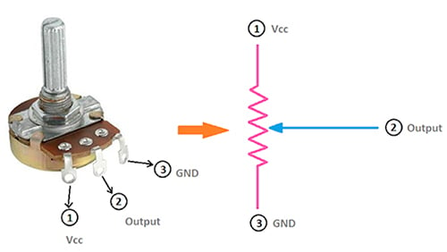

## Clase 30 de septiembre   
### Botón 4 patitas   
Funciona solo si se mantiene apretado, esta normalmente abierto.   

#### Conceptos de electrónica y Arduino

- Salida digital (digitalWrite): permite controlar el estado de un LED, encendiéndolo o apagándolo.   
- Entrada digital (digitalRead): permite leer el estado de un botón. Puede tomar los valores HIGH o LOW.

- Operador NOT (!): invierte un valor lógico. Si es true, pasa a false, y viceversa.

- Entrada analógica (analogRead): permite leer valores variables, por ejemplo, los de un potenciómetro. (~)

- Salida PWM (analogWrite): permite controlar el brillo de un LED mediante la variación de la señal PWM.

Potenciómetro: componente que permite variar la resistencia y obtener una tensión variable. Funciona como divisor de voltaje.

Funciones utilizadas   
variable = digitalRead(botonPin); // Leer una entrada digital   
digitalWrite(ledPin, estado); // Controlar una salida digital   
variable = analogRead(potenciometroPin); // Leer una entrada analógica   
analogWrite(ledPin, valor); // Controlar una salida PWM   

Divisor de voltaje   

