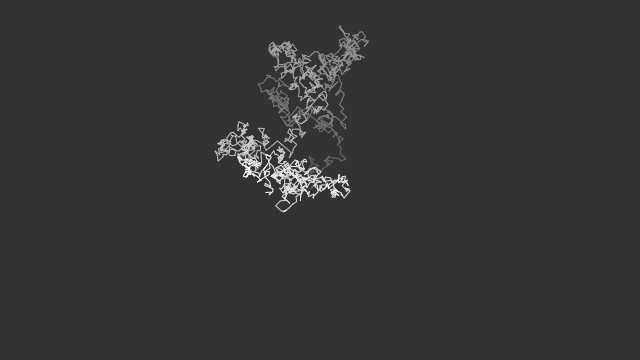
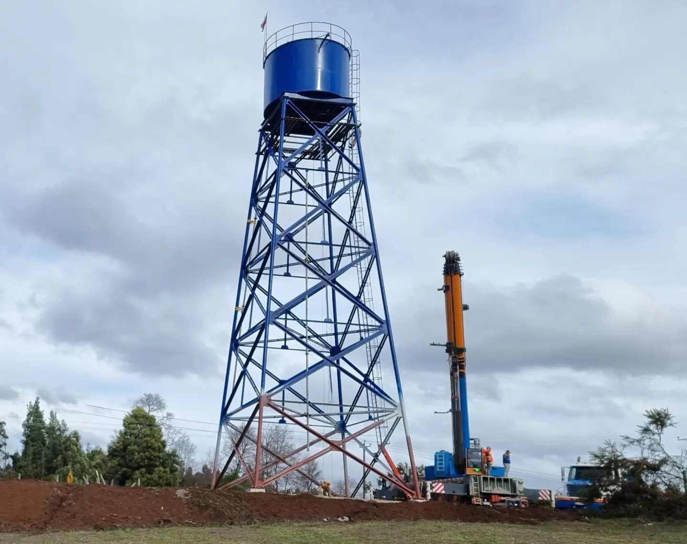
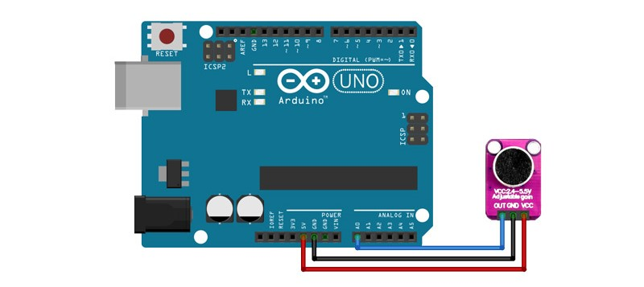
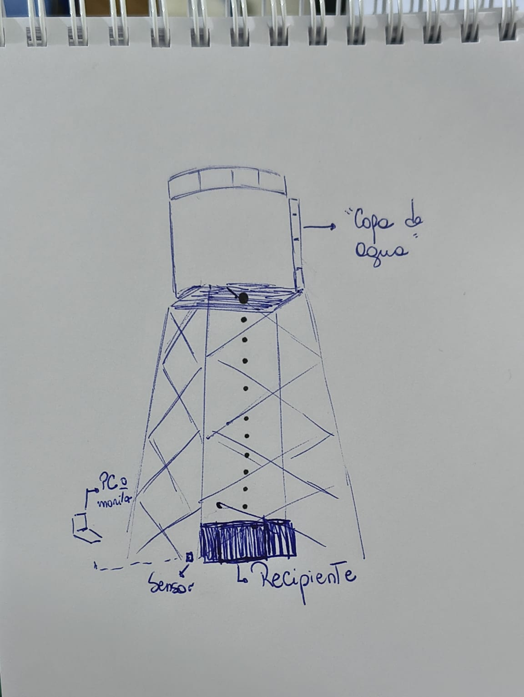

#### Descripción formal de lo que quieren hacer (1 párrafo):   
El proyecto consiste en la construcción de un dispositivo que transforma el goteo de agua en una representación visual asemejando un cauce, generada en tiempo real. Mediante un sistema de dos recipientes, uno arriba que actúa por gravedad como una torre de agua, el agua cae de manera intermitente sobre un contenedor receptor, donde los impactos producen variaciones sonoras que son captadas por un micrófono MAX4466 (idealmente que luego sea un sistema donde el agua pase en dos electrodos o trozos de cobre que actúen como interruptor). La señal es recibida por un Arduino y posteriormente enviada a P5.js, donde se traduce en parámetros gráficos que permiten construir progresivamente una forma de río. La intensidad sonora modifica la amplitud y curvatura de los trazos, de este modo, la imagen no se encuentra previamente definida, sino que aparece y se transforma a medida que ocurre el goteo. 
Un ejemplo de la representación visual que intentaré buscar es un ejemplo de processing: Brownian motion (desplazamiento aleatorio e irregular de partículas microscópicas suspendidas en un fluido (líquido o gas) debido a los choques constantes con las moléculas del medio), que en este caso no serán datos aleatorios sino que estarán dados por el sensor que utilice.   
    
Sensores:    
- MAX4466: El módulo MAX4466 es un preamplificador de micrófono electret diseñado para captar sonido ambiente (entre 20 Hz y 20 kHz) y convertirlo en una señal analógica limpia y legible para microcontroladores como Arduino o ESP32. Integra el circuito amplificador operacional MAX4466 de bajo ruido y bajo consumo (operando entre 2.4 V y 5.5 V DC) junto con un potenciómetro trasero que permite ajustar su ganancia de 25x a 125x. A diferencia de los sensores de sonido digitales básicos, entrega la onda de audio completa con un offset de VCC/2 en silencio, lo que lo hace ideal para proyectos de grabación de voz, análisis de frecuencias (FFT), vúmetros digitales y sistemas reactivos al audio. 
- Sensor de lluvia (sensor MH-RD / YL-83): dispositivo electrónico diseñado para detectar la presencia y la intensidad de agua o lluvia sobre su superficie. Consta de dos partes principales: una placa colectora con pistas metálicas intercaladas (normalmente en circuito abierto) y un módulo comparador (basado en el integrado LM393) que procesa la señal. Su funcionamiento se basa en la conductividad del agua: al caer gotas sobre la placa colectora, el líquido cierra el circuito entre las pistas y disminuye la resistencia eléctrica de forma proporcional a la cantidad de agua acumulada. El módulo traduce esta variación en dos salidas simultáneas alimentadas entre 3.3V y 5V: una salida analógica (AO), que entrega un voltaje variable para medir la intensidad de la precipitación, y una salida digital (DO), que envía una señal de estado alto o bajo al superar un umbral de sensibilidad calibrable mediante su potenciómetro integrado. 

#### Conceptualización (1 párrafo):   
La obra parte de una pregunta presente en mi proyecto de egreso, cómo percibimos el agua cuando la conocemos a través de sistemas que la miden, registran y representan, es una pregunta que también se extiende a nuestra manera de relacionarnos con la naturaleza.
Este dispositivo aborda esa inquietud desde una escala mínima. Una gota cae, impacta sobre una superficie o recipiente y produce un sonido. Un sensor capta las variaciones sonoras y envía una señal a Arduino, donde es procesada para obtener valores que posteriormente son interpretados por P5.js.  A partir de este goteo, P5 irá agregando nuevos fragmentos a una línea que se va construyendo progresivamente, gota a gota, el dibujo se acumula hasta formar una trayectoria que reconocemos como un río.
Me interesa observar cómo un acontecimiento físico, aparentemente pequeño y cotidiano, puede ser capturado y transformado en información para adquirir una nueva forma de representación. El dibujo surge de la sucesión de impactos y de las reglas establecidas para traducir sus variaciones en parámetros gráficos.
   
 
#### Diagrama de flujo (con sensores y actuadores):       
**Recipiente superior con agua**   
   ↓   
**Goteo por gravedad**   
   ↓
**La gota impacta sobre un recipiente**   
   ↓   
**Se produce una variación sonora**   
   ↓    
**El micrófono MAX4466 (sensor) capta el sonido**    
   ↓    
**Arduino recibe la señal analógica**    
   ↓    
**Procesamiento de la señal**    
   ↓    
**Detección de un posible impacto**
   - Si no se detecta: continúa leyendo la señal.
   - Si se detecta: calcula la intensidad sonora.
   ↓    
**Envío de datos mediante comunicación serial**    
   ↓    
**Processing recibe los datos**    
    ↓    
**Cada impacto agrega un fragmento al dibujo**   
    ↓     
**La intensidad sonora modifica la curvatura**    
    ↓    
**El tiempo entre gotas modifica la continuidad**    
    ↓    
**Construcción progresiva de una línea que representa un río**    

#### Dibujo esquemático (cómo va conectado al Arduino):
    
#### Boceto de instalación. Ojalá tenga escala, referencias, sitio en la sala, sensores y actuadores: 
    
**Medidas**   
1m x 1m x 1m   
Uso de piso, si proyecto el río en vivo, necesito una pantalla o muro.
